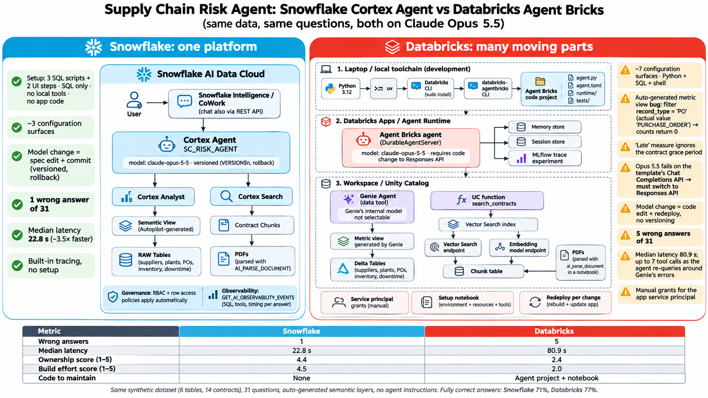

# Genie vs Cortex: Supply Chain Risk Agent Comparison

This project compares a **Databricks Agent Bricks agent** with a **Snowflake Cortex Agent (CoWork)** on the same use case, the same synthetic data and the same questions. You evaluate the answers by hand.

- **Background:** `agents.md` (architectures) and `genie_lab_setup_and_constraints.md` (Genie limits and failure patterns).
- **Use case:** "A major supplier missed delivery dates. Determine the financial exposure, check the contract breach terms, and estimate the penalty we can claim."
- **Out of scope:** external MCP and Jira.



*Both agents on Claude Opus 5.5, same data and 31 questions. Full results: [`eval/scorecard.md`](eval/scorecard.md).*

---

## 1. Project layout
```
README.md                          <- this guide (the only one)
agents.md                          <- background: architectures
genie_lab_setup_and_constraints.md <- background: Genie failure patterns
data/output/                      <- shared dataset (CSVs, contract PDFs, expected_answers.json); use as-is
setup/snowflake/01..03_*.sql       <- Snowflake setup scripts (+ Autopilot and agent UI steps)
setup/databricks/databricks_setup.ipynb  <- Databricks setup (one notebook)
eval/questions.md                  <- 32 questions with expected answers
eval/scorecard.md                  <- scores from the reference run (both on Claude Opus 5.5)
eval/usage_queries.sql             <- tool calls and latency from the traces (both platforms)
eval/ground_truth.sql              <- optional: proves data parity across platforms
docs/architecture.png              <- architecture and results diagram
```

## 2. What is compared
| | Databricks | Snowflake |
|---|---|---|
| **Agent** | Agent Bricks CLI agent (DurableAgentServer on Agent Runtime) | Cortex Agent (serves CoWork and REST) |
| **Data tool** | Genie Agent over the tables and a Genie-generated metric view | Cortex Analyst on an Autopilot-generated semantic view |
| **Contract tool** | UC function over a Vector Search index | Cortex Search service |

**Fairness rules:**
- **Same model on both:** Claude Opus 5.5. Snowflake `claude-opus-5-5` (the reference run used `auto`, which resolved to it); Agent Bricks `system.ai.claude-opus-5-5`. The Genie Agent's internal model can't be chosen, and that's recorded as a finding.
- **No hand-built semantic layer:** Snowflake uses **Semantic View Autopilot**; Databricks uses a **Genie prompt** to build the metric view.
- **No business rules given:** each platform gets only the same one-line description, "Supply chain performance for Contoso Manufacturing in 2025: suppliers, plants, components, purchase orders, daily inventory and downtime events.". There are no business definitions, instructions, SQL examples or synonyms, so the traps test what each platform works out by itself.
- **Fixes are recorded:** if a generated artifact needs a manual fix, write it down, with the minutes spent. That counts towards the ownership comparison.

## 3. Data and seeded traps
- **Data:** 12 suppliers, 5 plants, 40 components, 3,000 purchase orders, 18,250 daily inventory rows, 150 downtime events, and 14 contract PDFs (12 agreements plus 2 amendments). The period is calendar year 2025.
- **Traps:** deliberately seeded to trigger the known Genie failure patterns:

| Trap | What | Correct behaviour |
|---|---|---|
| T1 | The `is_late` flag is wrong on about 3% of rows | Late = delivered more than the contract grace days after the promised date (513, not 573) |
| T2 | Region exists on both plant and supplier | Use the plant region |
| T3 | Downtime has planned and unplanned events | "Downtime cost" means unplanned only |
| T4 | Look-alike suppliers: ACME SUPPLIES (SUP-101) / ACME SUPPLY CO (SUP-110), NORTHWIND / NORTHWINDS | Resolve the right supplier, or ask |
| T5 | Components C-12 and C-25 have flat inventory | Say there's no trend |
| T6 | Amendments for SUP-101 and SUP-104 change the penalty % and the cap | The amendment overrides the original |
| T8 | Open and cancelled POs | Filter correctly |
| T9 | Force majeure for SUP-105, March 2025 | Exclude that period from the penalty |

---

## 4. Setup

### Step 0: Data and your settings
The dataset is shipped in `data/output/` (`csv/`, `contracts/`, `expected_answers.json`). Everyone uses the same files, so results are comparable. Don't regenerate or edit them.

Values you choose for your environment (used below):

| Placeholder | Meaning | Example |
|---|---|---|
| `<REPO_PATH>` | Absolute path to this repo on your laptop | `/Users/me/genie_cortex` |
| `<your_catalog>` | Unity Catalog catalog you can create objects in | `main` |
| `<WORKSPACE_URL>` | Databricks workspace root URL | `https://adb-123.4.azuredatabricks.net` |
| `<PROFILE>` | Databricks CLI profile name | `sc-eval` |
| `<GENIE_AGENT_ID>` | ID of your Genie Agent (from its URL) | `01f1...` |

### Step 1: Snowflake
Run as ACCOUNTADMIN, in a Snowsight worksheet or with `snow sql -f <file>`.

| # | File / action | Notes | Done when |
|---|---|---|---|
| 1 | `setup/snowflake/01_db_and_data.sql` | Uncomment the `PUT` line and replace `<REPO_PATH>`, or upload `data/output/csv/*.csv` to `@RAW.DATA_STAGE` in Snowsight | Row counts are 12 / 5 / 40 / 3000 / 18250 / 150 |
| 2 | **Semantic View Autopilot (UI)** | See below | `SUPPLY_CHAIN_EVAL.ANALYTICS.SV_SUPPLY_CHAIN` exists |
| 3 | `setup/snowflake/02_cortex_search.sql` | `PUT` `data/output/contracts/*.pdf` to `@DOCS.CONTRACTS_STAGE` first (replace `<REPO_PATH>`) | 14 docs; the search preview returns the SUP-101 docs |
| 4 | **Create the agent (UI)** | See below | `SC_RISK_AGENT` is listed under AI & ML → Agents |
| 5 | **Add to CoWork (UI)** | On the agent's page, add it to Snowflake Intelligence | The agent appears in CoWork |
| 6 | `setup/snowflake/03_governance.sql` | Run **after** the baseline questions. It grants the test role to the current user (change `TEST_USER` to use another user) | The restricted role sees only PLT-02 and PLT-05 |

**Semantic View Autopilot (step 2):**
1. Snowsight → **Workspaces** → **Add new** → **Semantic View** (use the standard wizard).
2. Location and name: `SUPPLY_CHAIN_EVAL.ANALYTICS`, name `SV_SUPPLY_CHAIN`.
3. **Description:** "Supply chain performance for Contoso Manufacturing in 2025: suppliers, plants, components, purchase orders, daily inventory and downtime events." Leave **SQL queries** empty.
4. **Tables:** all six in `SUPPLY_CHAIN_EVAL.RAW`. **Columns:** select all, with sample values and AI descriptions on.
5. Select **Create and save**, then **Save and run**. When the Cortex Analyst suggestions appear (this can take a few minutes), **apply all of them**. Don't make any other manual edits.

**Create the agent (step 4):**
1. Snowsight → **AI & ML** → **Agents** → **Create agent**.
   - Location: `SUPPLY_CHAIN_EVAL.ANALYTICS`.
   - Object name: `SC_RISK_AGENT`. Display name: *Supply Chain Risk Analyst*.
2. **Orchestration model:** `claude-opus-5-5` (the reference run used `auto`, which resolved to it). If it isn't listed, run `ALTER ACCOUNT SET CORTEX_ENABLED_CROSS_REGION = 'ANY_REGION';`.
3. **Instructions:** leave both **Orchestration instructions** and **Response instructions** empty. The Agent Bricks agent and its Genie Agent get no instructions either.
4. **Tools → Cortex Analyst:**
   - Semantic view: `SUPPLY_CHAIN_EVAL.ANALYTICS.SV_SUPPLY_CHAIN`. Warehouse: `SC_EVAL_WH`.
   - Name: `supply_chain_data`.
   - Description: select **Generate with Cortex** and keep the generated text unedited.
5. **Tools → Cortex Search:**
   - Service: `SUPPLY_CHAIN_EVAL.DOCS.CONTRACTS_SEARCH`. ID column: `RELATIVE_PATH`. Title column: `DOC_NAME`. Max results: 5.
   - Name: `contract_search`.
   - Description: *Supplier Master Supply Agreements (MSA) and amendments. Use for grace period, liquidated damages %, liability cap, force majeure and termination terms. Filter by SUPPLIER_ID (e.g. SUP-101) when known. Not for numbers from data.*
6. Select **Save**.

### Step 2: Databricks
1. Import `setup/databricks/databricks_setup.ipynb` (**Workspace → Import**) and attach serverless compute.
2. Edit section 0 (`CATALOG`, and optionally `SCHEMA`, `VOLUME_NAME`, `VS_ENDPOINT`), then run it top to bottom. It stops at two **[UI]** steps.

| Notebook section | What you do | Done when |
|---|---|---|
| 0. Configuration | Set `CATALOG` (others have defaults). It creates the schema and volume if missing | It prints `<catalog>.supply_chain_eval` and the volume path |
| 1. Raw tables | Upload `data/output/csv/` and `data/output/contracts/` into the volume, run the file check (6 CSVs, 14 PDFs), then run the load cell | Row counts are 12 / 5 / 40 / 3000 / 18250 / 150 |
| 2. **[UI]** Metric view | Catalog Explorer → `<catalog>.<schema>` → Create → Metric view → Genie Code: paste the prompt from the notebook, then save as-is | `mv_supply_chain` is visible in Catalog Explorer (review its definition there) |
| 3. Contracts | Parse, chunk, Vector Search index, and the `search_contracts` UC function | 14 docs; the SUP-101 amendment is in the top 3 |
| 4. **[UI]** Genie Agent | Create `SC Risk Analyst (eval)` in the Genie UI with no instructions. It's the data tool for the Agent Bricks agent; test it there | Genie says 513 late deliveries; the WAYNE METALS cap is USD 120,000 |
| 5. Governance | Run **after** the baseline questions | Only PLT-02 and PLT-05 for `sc_emea_analyst` |

### Step 3: Databricks Agent Bricks agent (CLI)
This uses the current Databricks pattern: the **Agent Bricks CLI** (`databricks-agentbricks`, Beta) builds a code-based agent and serves it with **DurableAgentServer** on **Agent Runtime** (Databricks Apps). The legacy options (Supervisor Agent/API, AI Playground export, Model Serving agents) are **not** used. There's no UI equivalent, so run these steps in a terminal on your laptop. Every command supports `--help`.

**Prerequisites**
- Python 3.11+ (3.12 recommended), [`uv`](https://docs.astral.sh/uv/), and the [Databricks CLI](https://docs.databricks.com/aws/en/dev-tools/cli/install).
- Notebook sections 3 and 4 done: `<your_catalog>.supply_chain_eval.search_contracts` and the Genie Agent `SC Risk Analyst (eval)` exist.
- Your Genie Agent's **Agent ID** (`<GENIE_AGENT_ID>`; the CLI calls it `SPACE_ID`, since Genie Agents were formerly Genie spaces). It's in the Genie Agent URL: `.../genie/spaces/<GENIE_AGENT_ID>`.

**3.1 Install and sign in**
```bash
# one-time tool installs (skip any you already have)
curl -LsSf https://astral.sh/uv/install.sh | sh && source $HOME/.local/bin/env                 # uv
curl -fsSL https://raw.githubusercontent.com/databricks/setup-cli/main/install.sh | sudo sh     # Databricks CLI
uv tool install --python 3.12 databricks-agentbricks
databricks auth login --host "<WORKSPACE_URL>" --profile <PROFILE>   # workspace ROOT url only
agentbricks login --profile <PROFILE>                               # save as default profile
```

**3.2 Scaffold the project**
```bash
agentbricks init sc-risk-agent --framework openai     # OpenAI Agents SDK + DurableAgentServer + chat UI
cd sc-risk-agent
```
`init` writes `agent.toml`. It records the deploy name (the app becomes `agent-bricks-sc-risk-agent`) and declares a memory store, a session store and an MLflow trace experiment.

**3.3 Add the two tools** (each command writes a `[[tools]]` entry to `agent.toml`)
```bash
agentbricks tools add genie-agent <GENIE_AGENT_ID> --name supply_chain_data
agentbricks tools add uc-function <your_catalog>.supply_chain_eval.search_contracts --name contract_search --auth app
agentbricks tools list                                # both tools should be listed
```
- **Genie tool:** runs as the person chatting (`--auth user`, the default), so Unity Catalog permissions and the row filter apply. Q36 depends on this.
- **Contracts tool:** a UC function, so it runs as the app's service principal (`--auth app`).

**3.4 Set the model**
- In `agent/agent.py`, make two changes:
  ```python
  MODEL = resolve_model_service() or "system.ai.claude-opus-5-5"   # was claude-sonnet-4-5
  set_default_openai_api("responses")                              # in configure(); was "chat_completions"
  ```
- **Why the Responses API:** with tool calling, Opus 5.5 returns reasoning blocks that the template's `chat_completions` path can't parse (`ValidationError: ResponseTextDeltaEvent.delta – Input should be a valid string`). Thinking can't be turned off for Opus 5.5. The Responses API handles reasoning output and also works for Opus 4.8 and Sonnet 4.5.
- Keep the template's default instructions, for parity with the other agents.
- To see the models available to you: `agentbricks experimental models list`.

**3.5 Check, test locally, deploy**
```bash
agentbricks doctor .            # validates agent.toml and the server wiring
agentbricks dev                 # local server + chat UI at http://localhost:8000
agentbricks deploy              # first deploy takes a few minutes; prints the app URL
agentbricks deployments list    # agent-bricks-sc-risk-agent should be RUNNING
```
- **Grants made by deploy:** it grants the app access only to resources declared in `agent.toml` (CAN RUN on the Genie Agent, EXECUTE on `search_contracts`).
- **Grants you make by hand:** grant the app's service principal `USE CATALOG`, `USE SCHEMA` and `SELECT` on `<your_catalog>.supply_chain_eval`, and `SELECT` on the vector index `contract_chunks_idx`. The service principal is shown under **Compute → Apps → agent-bricks-sc-risk-agent**.
- **If deploy fails:** check `agentbricks deployments logs agent-bricks-sc-risk-agent`.

**3.6 Smoke test**
```bash
agentbricks endpoint invoke agent-bricks-sc-risk-agent --path /api/invocations \
  --json '{"input":[{"role":"user","content":"What liquidated damages can we claim from ACME SUPPLIES (SUP-101) for 2025?"}]}'
```
- Expect about USD 400,000, using the SUP-101 amendment.
- For the evaluation, use the chat UI at the app URL printed by `deploy`.

**3.7 Where to get the metrics**
- **Tool calls and latency:** `agentbricks tracing list`, then `agentbricks tracing get <trace_id>`. Or open the MLflow experiment named in `agent.toml` under `[tracing]`. See also `eval/usage_queries.sql`.

---

## 5. Running the evaluation (manual)
1. Open `eval/questions.md`. It has the 32 questions, the expected answer, the "wrong answer if trap hit" value, and what to check.
2. Ask the questions in order, in **one chat session per system** (same conditions on every system):
   - **CoWork:** the *Supply Chain Risk Analyst* agent.
   - **Agent Bricks agent:** the chat UI at the `agent-bricks-sc-risk-agent` app URL.
3. **Q36:** ask it after running governance, as the restricted user.
4. Record each answer and score it with the rubric below.
5. Use `eval/usage_queries.sql` to get tool calls and latency per question from each platform's traces.

### Rubric
| Column | Score |
|---|---|
| correct (Y/N/P) | **Y** = matches the expected answer (±0.5% for money). **P** = partly right. **N** = wrong. A clarifying question counts as Y where the sheet says so |
| grounded (1–5) | 5 = every number and claim traces to the SQL, results or a cited clause. 1 = invented |
| relevant (1–5) | 5 = answers exactly what was asked, concisely |
| tool_calls | Steps or tools shown in the UI (SQL runs, searches) |
| latency_s | From the traces (`usage_queries.sql`) |
| failure_type | `wrong_metric`, `wrong_entity`, `wrong_attribution`, `ignored_amendment`, `missed_force_majeure`, `hallucinated_trend`, `missed_doc`, `governance_leak`, `no_answer`, `error` |

### Summary to report, per system
- Accuracy (% Y) and accuracy by tier (1 = lookup through 5 = data + contract; G = governance)
- Average grounded and relevant scores
- Median tool calls and median latency
- **Ownership** (O1–O5) and **Build effort** (B1–B4): see `eval/scorecard.md` for the criteria

Optional data-parity check: run `eval/ground_truth.sql` on both platforms. After `USE SCHEMA SUPPLY_CHAIN_EVAL.RAW` (Snowflake) or `USE CATALOG <catalog>; USE SCHEMA <schema>` (Databricks), the outputs should be identical.
