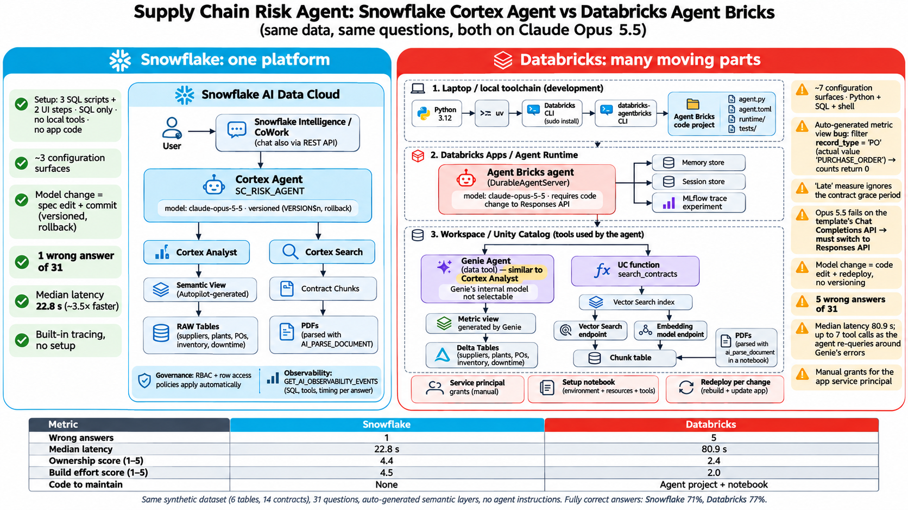

# Observations: Databricks Genie / Agent Bricks shortcomings

What we saw in the reference run. Both agents used **Claude Opus 5.5**, the same data and documents, the same 31 questions, auto-generated semantic layers and no agent instructions. Scores are in [`scorecard.md`](scorecard.md).

## Context: why we tested Agent Bricks

Databricks moved Supervisor Agent (GA February 2026) and Knowledge Assistant to legacy in October 2026, and retired the Supervisor API (beta April 2026) on September 30, 2026. Its recommended path is now a code-first agent built with the Agent Bricks CLI. That's a migration for customers on the declarative products, and a sign that the product surface isn't stable yet. The shortcomings below are what we found on that recommended path. Sources: [October 2026 release notes](https://docs.databricks.com/gcp/en/release-notes/product/2026/october), [Supervisor API (deprecated)](https://docs.databricks.com/aws/en/agents/agent-bricks/supervisor-api).

## Results at a glance

| | Snowflake Cortex Agent | Databricks Agent Bricks |
|---|---|---|
| Correct / partial / wrong (3 runs × 31 questions) | **75** / 16 / **2** | 71 / 12 / 10 |
| Fully correct | **81%** | 76% |
| Questions answered wrong in any run | **2** | 6 |
| Median latency per run | **23–31 s** | 65–81 s (2–3.5× slower) |
| Ownership score (1–5) | **4.4** | 2.4 |
| Build effort score (1–5) | **4.5** | 2.0 |
| Code to maintain | **None** | Agent project + setup notebook |

Across three runs on the same model, Snowflake got more answers fully right (81% vs 76%) and gave **5× fewer wrong answers** (2 vs 10). Databricks took **2–3.5× longer** per answer and needed much more setup and code. In the first run alone Databricks had 2 more fully correct answers; that didn't hold up over the repeat runs. The shortcomings below explain why.

## 1. Genie's auto-generated metric view contains silent errors

| Problem | Evidence | Effect |
|---|---|---|
| **Wrong filter value** | Genie filters `record_type = 'PO'`, but the value in the view is `'PURCHASE_ORDER'` | Purchase-order counts return **0 / null**: delivered, open, late and lag. The measures are correct when queried directly (234 open, 2,645 delivered) |
| **"Late" ignores the contract** | The `late` / `on_time_delivery_rate` measures use lag > 0. The grace-period rule exists only as a separate `contract_breach_rate` measure | On-time rate 47.6% instead of 75.64% (Q11); late value $7.24M instead of $2.54M (Q12) |
| **No financial-exposure measure** | Genie answers "exposure" with total PO spend | Exposure inflated 2–3× (for example $29.89M vs $11.56M for ACME SUPPLIES) |
| **Lag clamped at 0** | Early deliveries counted as 0 days | Average lag 2.3 days instead of 1.36 (Q03) |

These errors return plausible-looking numbers, so they're easy to miss without a test set.

## 2. The agent spends its effort working around Genie

- **The wins come from the model, not Genie.** Opus 5.5 rejected Genie's 0 (Q01) and Genie's spend-based exposure (Q13), then re-queried the raw tables using the contract rules. That's why Databricks' accuracy rose from 39% (Sonnet 4.5) to 77%.
- **The workarounds are slow.** Up to **8 tool calls** per question, with 100–170 s on the hardest questions. Median latency was 65–81 s per run, against 23–31 s for Snowflake.
- **The failures come from trusting Genie's measures** (Q03, Q07, Q11, Q12). Q09 (APAC exposure) was wrong in all three runs: the agent never offered the plant-region figure. When the agent accepted Genie's number, the answer was wrong.
- **Genie's own model can't be chosen.** Changing the Agent Bricks model only changes orchestration. Every data question still goes through Genie, so the metric-view errors stay whatever model you pick.

## 3. Using a new model needed debugging and code changes

- **The template breaks with Opus 5.5.** Agent Bricks' template calls the model through Chat Completions. With tool calling, Opus 5.5 returns reasoning blocks that the template can't parse (`ValidationError: ResponseTextDeltaEvent.delta – Input should be a valid string`). The failure rate was 0/6 runs in testing and about 50% in the deployed app.
- **Thinking can't be turned off** for Opus 5.5 (`thinking.type.disabled` is rejected).
- **Fix:** `set_default_openai_api("responses")` in `agent.py`, then redeploy. The fix isn't documented; we found it by debugging.
- **No versioning or rollback.** Every model change is a code edit plus a redeploy. Snowflake's is a spec change plus a commit, with earlier versions kept for rollback.

## 4. More setup surfaces, tools and code

| | Snowflake | Databricks |
|---|---|---|
| Configuration surfaces | ~3 | ~7: notebook, metric view prompt, Genie Agent, Vector Search, local CLIs, Agent Bricks project, deploy + grants |
| Languages | SQL | Python, SQL, shell |
| Local tooling | None | Python 3.12, `uv`, Databricks CLI (sudo), `databricks-agentbricks` |
| Code to own | None | Generated agent project (`agent/`, `runtime/`, `tests/`) + notebook |
| Manual grants | None | App service principal: USE CATALOG / SCHEMA, SELECT, vector index SELECT |
| Manual fixes during the evaluation | 1 (chunk headers) | 5 (chunk headers, CLI install / host URL, demo tools, Responses API switch, metric view bug unresolved) |

## 5. Retrieval and observability

- **You manage the retrieval stack yourself:** a Vector Search endpoint, an embedding endpoint, index sync, and a UC function wrapper. Snowflake's Cortex Search is one service.
- **Chunk metadata was missing on both platforms.** Without supplier names in the chunks, Agent Bricks hit its 10-turn limit on two contract questions before the fix. We applied the same fix on both platforms.
- **Observability gaps:**
  - Genie's internal model calls and tokens aren't exposed.
  - The billing, serving and query-history system tables need admin grants, so a fair token or cost comparison wasn't possible.
  - Snowflake's `GET_AI_OBSERVABILITY_EVENTS` returns SQL, tools and timing for each answer with no setup.

## Where Databricks did well

- **More consistent citations.** It cited contract section numbers (§5.1, §7.1, §8.1) more often than Snowflake.
- **Look-alike names in run 1:** 6/6 on Tier 3, against 3/3/0 for Snowflake. Over three runs Snowflake led this tier (14/4/0 vs 12/6/0).
- **Multi-step contract questions:** with Opus 5.5 it found extra relevant facts. On Q31 it found that ACME SUPPLIES was below 70% on-time in every quarter, which gives a termination right.

## Where Snowflake fell short

- **Questions using "late":** in runs 1 and 2 it often led with the `IS_LATE` flag before giving the grace-period figure. By run 3 it led with the grace-period figure.
- **Region:** it defaulted to supplier region rather than plant region (Q10 partial in all three runs; Q09 wrong once).
- **Citations:** section numbers were cited less consistently.
- **Business rules:** Autopilot didn't encode the grace-period rule or the exposure formula either. Snowflake recovered more often, but both semantic layers would need curation for production.

## Limitations

- Three runs per platform (93 answers each), on synthetic data with seeded traps that target known Genie failure patterns.
- Questions were sent through the APIs, not the chat UIs.
- A token or cost comparison wasn't completed.
